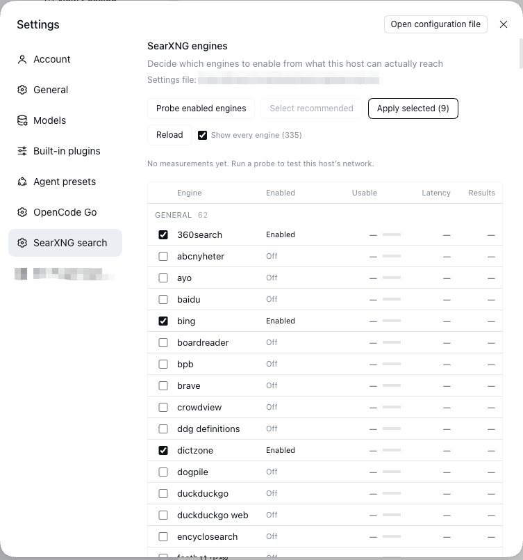
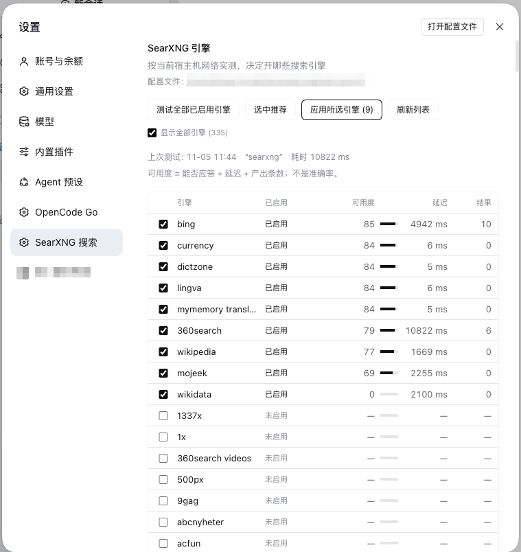

# dsh-searxng-search

English | [中文](README.zh.md)

One-click local search engine for [DeepSeek Harness](https://github.com/deepseek-ai): free, fast,
and reliable. It installs [SearXNG](https://github.com/searxng/searxng) on your machine, keeps it
running, and points `web_search` at it — no API key, no subscription.



The base layer pins `ctx.web` to `searchProvider: deepseek-official`, which needs
`DEEPSEEK_API_KEY`. Without that credential `searchReady()` answers false and the
`web_search` tool is withheld from every model step — the agent is left with
`web_fetch` only. This plugin registers a credential-free provider backed by a
SearXNG instance you run yourself.

## What it adds

| Piece | What it does |
|---|---|
| Provider | Registers search provider `searxng` on `ctx.web`. The shipped `web_search` tool keeps its schema, formatting, and result card. |
| Supervision | Probes `/healthz` before every search; when the server is down it restarts it through launchd, systemd, a Windows task, or a child process it owns. |
| Installer | `scripts/bootstrap-searxng.sh` (macOS, Linux) and `scripts/bootstrap-searxng.ps1` (WSL) install or repair an instance idempotently. Never overwrites an existing settings file. |
| Settings page | Engine table grouped by category, one-click probe of the engines this host can reach, a recommended roster, and the outbound proxy. |
| Proxy | Reads and writes SearXNG's `outgoing.proxies.all://`, so engine requests can go through a local proxy. |

## Requirements

- DeepSeek Harness with a profile (`dsh.bundle` support).
- A reachable SearXNG instance. The installer needs `git`, Python 3.11+, and
  macOS, Linux, or WSL.
- SearXNG must serve JSON: `search.formats` has to include `json`.

## Install

```sh
# 1. Get a SearXNG to point at (skip if you already run one).
./scripts/bootstrap-searxng.sh            # macOS / Linux
./scripts/bootstrap-searxng.sh --print    # show the plan first

# 2. Install the plugin into a DSH profile.
#    In DSH: Plugins → install from a directory, or
#    dsh plugin install /path/to/dsh-searxng-search
```

Point the plugin at an existing instance by editing `config.baseUrl`; point it at
another machine and disable the supervisor with `ensure.enabled: false`.

## Configuration

```yaml
- id: searxng-search
  name: 'dsh-searxng-search'
  config:
    baseUrl: 'http://127.0.0.1:8888'
    settingsPath: '~/.local/share/searxng/searxng.yml'   # optional; this is the default
    id: searxng              # provider id the web service pins
    maxResults: 20           # provider-side floor; the tool caps again
    timeoutMs: 20000
    safesearch: 0
    probeTimeoutMs: 12000    # one engine probe
    # Optional SearXNG query parameters, omitted when empty:
    # language: zh-CN
    # categories: general
    # engines: google,bing
    ensure:
      enabled: true
      healthPath: /healthz
      probeTimeoutMs: 1500
      startupTimeoutMs: 20000
      probeIntervalMs: 400
      retryCooldownMs: 15000
      launchAgent: com.searxng.server   # macOS
      systemdUnit: ''                   # Linux, e.g. searxng.service
      windowsTask: ''                   # Windows (WSL only)
      windowsService: ''
      command: ''                       # universal fallback, plugin-owned
      args: []
      cwd: ''
      env: {}
```

## Platforms

| Platform | Supervisor | Installer | Status |
|---|---|---|---|
| macOS | LaunchAgent → `launchctl kickstart -k gui/<uid>/<label>` | `bootstrap-searxng.sh` | installed, self-heal and clean uninstall verified on a real machine |
| Linux | systemd user unit → `systemctl --user restart`, falling back to `systemctl restart` | `bootstrap-searxng.sh` | installer, settings, JSON API and the plugin round-trip verified in an Ubuntu 24.04 container; the unit itself only with a stubbed `systemctl` |
| Windows | — | `bootstrap-searxng.ps1` refuses outside WSL | **not supported natively**: SearXNG's `searx/valkeydb.py` imports the POSIX-only `pwd` module, so the server dies at import. Use WSL, Docker, or point this plugin at a Linux/macOS instance with `config.baseUrl` |

The plugin half is plain Node and runs anywhere; only the server is POSIX-bound.

## How supervision works

Every `web_search` probes `GET /healthz` first (1.5 s budget). If the server is
down, the plugin starts it and polls until healthy (20 s budget), then runs the
search:

1. This platform's supervisor, when configured and installed. That manager owns
   the process; the plugin never kills it.
2. Otherwise `ensure.command`, which the plugin spawns through `ctx.subprocess`,
   owns, and terminates when the plugin unloads.
3. Neither → the search fails with a message listing what was tried and which
   setting or installer would fix it.

A failed start is remembered for `retryCooldownMs`, and concurrent searches share
one recovery attempt. The provider implements no `ready()`, so `web_search` stays
admitted to every step: a down server surfaces as an actionable tool error instead
of a silently missing tool.

## The engine page



**Probe** runs one query per enabled engine in the `general` category, three at a
time, and scores each result 0–100:

| Component | Points | Rule |
|---|---|---|
| Answers | 55 | valid JSON and no `unresponsive_engines` entry for it |
| Latency | 25 / 18 / 10 / 4 / 0 | ≤0.8 s / ≤2 s / ≤5 s / ≤15 s / slower |
| Yield | 20 / 12 / 4 | ≥5 results / 1–4 / none |

That is a **usability** score, not accuracy: nothing compares an engine's answers
with ground truth. Accuracy would need a labelled corpus or cross-engine agreement
sampling; the page does not pretend to have it.

**Apply** writes one explicit switch per engine (`- name: "<engine>"` +
`disabled: true|false`) and drops `use_default_settings.engines.keep_only`. The
whitelist is a one-way door — after it is written `/config` only returns the kept
engines, so every other engine disappears from the page and cannot be turned back
on. The first apply migrates the file away from it; the page also lists engines
parsed from SearXNG's own `searx/settings.yml`, so the catalog is complete even
before that migration.

Every write keeps a timestamped backup next to the settings file, restarts the
instance, waits for health, and restores the backup if the instance does not come
back.

## Security

- **No credentials.** The provider has no key and implements no `ready()`.
- **Loopback by default.** The installer binds `127.0.0.1`. `SEARXNG_BIND=0.0.0.0`
  exists for containers and puts the exposure decision on you.
- **The settings file is the only file it writes**, and only through the page's
  apply/proxy actions: timestamped backup first, verify, roll back on failure.
- **Process control is limited to the configured supervisor.** `launchctl`,
  `systemctl`, `schtasks`, or the explicit `ensure.command`; nothing is discovered
  or killed by pattern.
- **No telemetry, no remote calls.** The only network traffic is to your own
  instance.
- **All results are external data.** They pass through the stock `web_search`
  result formatting and the harness's untrusted-content notice unchanged.

## Troubleshooting

| Symptom | Cause |
|---|---|
| `web_search` is missing from the tool list | Another provider is pinned and unavailable. Check `web.provider`/`searchProvider` and `GET /dsh-searxng/engines`. |
| Search returns 0 results | Engine roster is empty or every engine was CAPTCHA-blocked. Probe from the settings page. |
| `did not answer within N ms` | The instance is down and could not be restarted; the error names the strategy that failed. |
| `HTTP 500` on a search | SearXNG refused the JSON format. Add `json` to `search.formats`. |
| Engines vanish after applying | You are on an old build: apply used to write `keep_only`. Update to 0.4.3+, then apply once to migrate. |

## Development

| File | Role |
|---|---|
| `index.js` | Host plugin: provider, supervision, platform restarts |
| `engines.js` | Pure helpers: scoring, roster/proxy text surgery, catalog parsing |
| `engine-api.js` | Host routes: `GET /dsh-searxng/engines`, `POST /probe`, `/apply`, `/proxy` |
| `client.js` | Settings page: table, probe/apply buttons, proxy field, zh/en dictionaries |
| `scripts/bootstrap-searxng.sh` | Idempotent installer for macOS and Linux |
| `scripts/bootstrap-searxng.ps1` | Same, for WSL; refuses natively |

Routes are host-only JSON. The client renders them and never touches the settings
file.

## Known limits

- The installer targets macOS LaunchAgents and systemd user units; other init
  systems are out of scope.
- `bing`, `sogou`, `360search` are the tamest engines on a CN route; several
  upstream defaults (`google`, `brave`, `duckduckgo`, `startpage`, `qwant`,
  `baidu`) are CAPTCHA- or rate-limited, and `wikipedia` can cost 15 s before its
  own timeout — it is out of the default roster for that reason.
- Search requests carry only `query`; recency and domain filters are not exposed
  by the harness seam.
- The accuracy question above is deliberately unanswered.

## License

MIT
