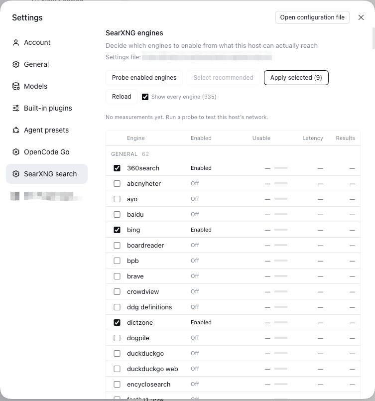
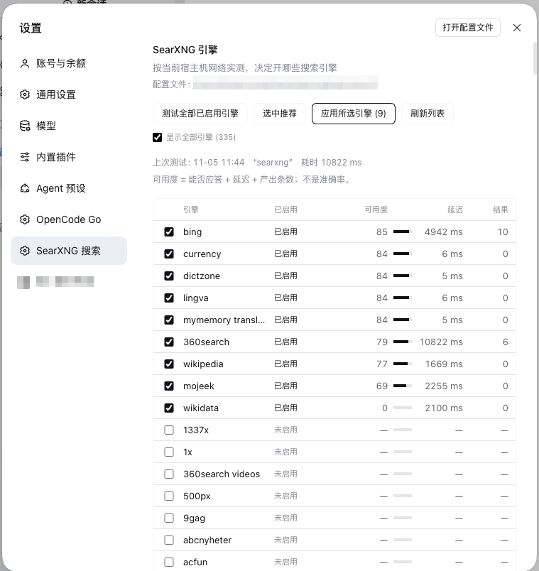

# dsh-searxng-search

[English](README.md) | 中文

给 [DeepSeek Harness](https://github.com/deepseek-ai) 的一键本地搜索。它在你自己机器上装好
[SearXNG](https://github.com/searxng/searxng)、保持它活着，再把 `web_search` 指过去。

- **无需 API。** 不用注册、不用存任何厂商密钥，装完就能搜。
- **完全免费。** 自己托管：没有订阅、没有按次计费、没有额度。
- **自动选最佳线路（靠实测，不靠猜）。** 设置页在你自己的网络上逐个实测引擎，按应答、延迟、
  产出打分，一键选出能用的组合。
- **结果干净。** SearXNG 聚合多个高效引擎（Bing、Sogou、360search 等），无广告、无追踪、
  无跳转包装。



基座把 `ctx.web` 钉在 `searchProvider: deepseek-official` 上，那个 provider 需要
`DEEPSEEK_API_KEY`。没有密钥时 `searchReady()` 返回 false，`web_search` 会被从每
一个模型步骤里摘掉——agent 只剩 `web_fetch`。这个插件注册一个不需要任何凭证的
provider，指向你自己跑的 SearXNG。

## 它加了什么

| 部分 | 作用 |
|---|---|
| Provider | 在 `ctx.web` 上注册搜索 provider `searxng`。原生 `web_search` 的 schema、排版、结果卡片全部不变。 |
| 守护 | 每次搜索前探 `/healthz`；服务挂了就按平台拉起：launchd、systemd、Windows 计划任务，或插件自己持有的子进程。 |
| 安装器 | `scripts/bootstrap-searxng.sh`（macOS、Linux）与 `scripts/bootstrap-searxng.ps1`（WSL），幂等安装或修复，绝不覆盖已有配置文件。 |
| 设置页 | 按类别分组的引擎表、一键实测本机可达的引擎、推荐名单、出站代理。 |
| 代理 | 读写 SearXNG 的 `outgoing.proxies.all://`，让引擎请求走本地代理。 |

## 环境要求

- 支持 `dsh.bundle` 的 DeepSeek Harness 与一个 profile。
- 一个可达的 SearXNG 实例。安装器需要 `git`、Python 3.11+，以及 macOS、Linux 或 WSL。
- SearXNG 必须支持 JSON 输出：`search.formats` 里要有 `json`。

## 安装

```sh
# 1. 先有一个 SearXNG（已经有了就跳过）
./scripts/bootstrap-searxng.sh            # macOS / Linux
./scripts/bootstrap-searxng.sh --print    # 只看计划，不动手

# 2. 把插件装进 DSH profile
#    DSH 里：插件 → 从目录安装；或
#    dsh plugin install /path/to/dsh-searxng-search
```

已有实例改 `config.baseUrl` 即可；实例在别的机器上（例如 NAS）时，用
`ensure.enabled: false` 关掉守护，交给那台机器自己管。

## 配置

```yaml
- id: searxng-search
  name: 'dsh-searxng-search'
  config:
    baseUrl: 'http://127.0.0.1:8888'
    settingsPath: '~/.local/share/searxng/searxng.yml'   # 可省略，这是默认值
    id: searxng              # web 服务钉住的 provider id
    maxResults: 20           # provider 侧上限，工具还会再截一次
    timeoutMs: 20000
    safesearch: 0
    probeTimeoutMs: 12000    # 单个引擎的探测超时
    # 可选的 SearXNG 查询参数，留空则不传：
    # language: zh-CN
    # categories: general
    # engines: google,bing
    ensure:
      enabled: true
      healthPath: /healthz
      probeTimeoutMs: 1500
      startupTimeoutMs: 20000
      probeIntervalMs: 400
      retryCooldownMs: 15000
      launchAgent: com.searxng.server   # macOS
      systemdUnit: ''                   # Linux，例如 searxng.service
      windowsTask: ''                   # Windows（仅 WSL）
      windowsService: ''
      command: ''                       # 通用兜底，进程归插件
      args: []
      cwd: ''
      env: {}
```

## 平台

| 平台 | 守护方式 | 安装器 | 状态 |
|---|---|---|---|
| macOS | LaunchAgent → `launchctl kickstart -k gui/<uid>/<label>` | `bootstrap-searxng.sh` | 真机验证：安装、自愈、干净卸载 |
| Linux | systemd user unit → `systemctl --user restart`，失败退到 `systemctl restart` | `bootstrap-searxng.sh` | 在 Ubuntu 24.04 容器里验证过安装、配置、JSON API 与插件往返；unit 本身只用 stub 的 `systemctl` 验过 |
| Windows | — | `bootstrap-searxng.ps1` 在非 WSL 环境直接拒绝 | **原生不支持**：SearXNG 的 `searx/valkeydb.py` 导入了 POSIX 专有的 `pwd`，进程在 import 阶段就死。走 WSL、Docker，或用 `config.baseUrl` 指向 Linux/macOS 上的实例 |

插件本身是纯 Node，任何平台都能跑；受限的只有服务端。

## 守护怎么工作

每次 `web_search` 先探 `GET /healthz`（1.5 秒预算）。服务掉线就拉起来并轮询到健康
（20 秒预算），然后执行搜索：

1. 当前平台配置好且已安装的托管器——进程归它，插件不杀。
2. 否则用 `ensure.command`，插件通过 `ctx.subprocess` 拉起、持有，卸载时回收。
3. 都没有 → 搜索失败，错误信息列出试过什么、该配哪一项或跑哪个安装器。

启动失败会记 15 秒冷却，并发搜索共用同一次恢复。provider 不实现 `ready()`，所以
`web_search` 永远在工具列表里：服务挂了是模型能读懂的错误，而不是工具凭空消失。

## 引擎页



**测试**：对 `general` 类别里已启用的引擎各发一次查询，三路并发，按 0–100 打分：

| 分项 | 分值 | 规则 |
|---|---|---|
| 应答 | 55 | 返回合法 JSON 且 `unresponsive_engines` 里没有它 |
| 延迟 | 25 / 18 / 10 / 4 / 0 | ≤0.8 秒 / ≤2 秒 / ≤5 秒 / ≤15 秒 / 更慢 |
| 产出 | 20 / 12 / 4 | ≥5 条 / 1–4 条 / 无结果 |

这是**可用度**，不是准确率：没有任何环节拿引擎的答案去跟标准答案比对。准确率需要
标注语料或跨引擎一致性采样，页面不假装自己有。

**应用**会为每个引擎写一条显式开关（`- name: "<引擎>"` + `disabled: true|false`），
并移除 `use_default_settings.engines.keep_only`。那个白名单是单向门——写进去之后
`/config` 只返回名单内的引擎，其余全部从页面消失且再也打不开。首次应用会把配置迁
移出白名单；页面同时会解析 SearXNG 自带的 `searx/settings.yml`，所以即使在迁移前，
可选目录也是完整的。

每次写入都在配置文件旁留一份带时间戳的备份，重启实例、等待健康；没起来就自动回滚。

## 安全

- **不碰凭证。** provider 没有 key，也不实现 `ready()`。
- **默认只听回环。** 安装器绑 `127.0.0.1`。`SEARXNG_BIND=0.0.0.0` 是为容器准备的，
  暴露面由你决定。
- **只写一个文件**——你的 `searxng.yml`，且只在页面上点应用/保存代理时：先备份、再写、
  再校验，失败回滚。
- **进程控制限于配置里的托管器**：`launchctl`、`systemctl`、`schtasks` 或显式的
  `ensure.command`；不按名字扫进程，也不杀不认识的进程。
- **没有遥测、没有外部请求。** 唯一的网络流量是发给你自己的实例。
- **结果是外部数据。** 走原生 `web_search` 的格式化与 harness 的不可信内容提示，不做
  任何额外处理。

## 排错

| 现象 | 原因 |
|---|---|
| 工具列表里没有 `web_search` | 钉住的 provider 不可用。检查 `web.provider` / `searchProvider`，或看 `GET /dsh-searxng/engines`。 |
| 搜索返回 0 条 | 引擎名单为空，或全部被 CAPTCHA 挡了。去设置页测一遍。 |
| `did not answer within N ms` | 实例挂了且没拉起来，错误里会写明是哪个策略失败的。 |
| 搜索报 HTTP 500 | SearXNG 拒绝 JSON 输出，给 `search.formats` 加上 `json`。 |
| 应用之后引擎全消失 | 旧版本：应用会写 `keep_only`。升到 0.4.3+，再应用一次完成迁移。 |

## 代码结构

| 文件 | 作用 |
|---|---|
| `index.js` | 宿主插件：provider、守护、跨平台重启 |
| `engines.js` | 纯函数：评分、名单/代理的文本手术、目录解析 |
| `engine-api.js` | 宿主路由：`GET /dsh-searxng/engines`、`POST /probe`、`/apply`、`/proxy` |
| `client.js` | 设置页：表格、测试/应用按钮、代理输入、中英词典 |
| `scripts/bootstrap-searxng.sh` | macOS 与 Linux 的幂等安装器 |
| `scripts/bootstrap-searxng.ps1` | 同上，供 WSL 使用；原生环境直接拒绝 |

路由只返回 JSON，页面只负责渲染，从不直接改配置文件。

## 已知限制

- 安装器只覆盖 macOS LaunchAgent 与 systemd user unit，其他 init 系统不在范围内。
- 在 CN 线路上 `bing`、`sogou`、`360search` 最稳；上游默认的 `google`、`brave`、
  `duckduckgo`、`startpage`、`qwant`、`baidu` 普遍被 CAPTCHA 或限流，`wikipedia`
  可能拖到 15 秒，因此被排除在默认名单外。
- 搜索请求只带 `query`；时效和域名过滤 harness 这层还没开放。
- 准确率的问题，这里故意不回答。

## 许可

MIT
